# HeroVerse project map

Generated by `migration/ops/project_map.py` from the repository; rerun it to update.

## Workflows (what runs, when, and what it calls)

| workflow | triggers | calls | dispatches |
|---|---|---|---|
| `approve.yml` | push, workflow_dispatch | ci/release_video.sh production/long_review.py production/signal_scan.py publish/preflight.py publish/prepublish_gate.py publish/three_stage.py | publish.yml |
| `arc-links.yml` | workflow_dispatch | ops/heartbeat.py publish/arc_links.py publish/test_arc_links.py | - |
| `cf-images.yml` | workflow_dispatch | ci/assets.sh ops/dispatch_guard.py production/imagegen/cf_images.py production/imagegen/upscale.py | - |
| `channel-config.yml` | workflow_dispatch | publish/channel_config.py | - |
| `channel-privacy.yml` | workflow_dispatch | channel/captions_audit.py channel/channel_privacy.py ops/heartbeat.py | - |
| `episode.yml` | workflow_dispatch | ci/assets.sh ops/dispatch_guard.py production/bible/episode_build.py production/bible/episode_order.py production/bible/lipsync_check.py production/bible/plan_check.py production/bible/syncnet.py production/pilot_render.py | - |
| `first-comment.yml` | workflow_dispatch | publish/first_comment.py | - |
| `footage.yml` | workflow_dispatch | ci/assets.sh ops/dispatch_guard.py production/footage/footage.py | - |
| `goal-report.yml` | workflow_dispatch | mining/goal_report.py mining/learning_loop.py mining/reach_report.py ops/health.py ops/heartbeat.py ops/minutes.py ops/runway.py | - |
| `heartbeat.yml` | schedule, workflow_dispatch (cron 41 * * * *) | ops/engine_fallback.py ops/heartbeat.py ops/runner_dispatch.py ops/test_engine_fallback.py ops/test_heartbeat.py ops/test_runner_dispatch.py production/render_queue.py publish/arc_links.py publish/tiktok_publish.py | pilot-preview.yml |
| `images-upres.yml` | workflow_dispatch | ci/assets.sh production/imagegen/upscale.py | - |
| `long-build.yml` | workflow_dispatch | ci/assets.sh ops/dispatch_guard.py production/bible/episode_build.py production/bible/lipsync_check.py production/bible/long_build.py production/bible/long_plan_check.py production/bible/syncnet.py production/pilot_render.py | - |
| `market-panel.yml` | workflow_dispatch | ci/assets.sh mining/daily_intel.py mining/market_forecast.py mining/market_panel.py mining/test_market_panel.py mining/ypp_market_model.py ops/heartbeat.py | - |
| `nightly-images.yml` | workflow_dispatch | ops/heartbeat.py production/render_queue.py | cf-images.yml |
| `pavo-footage.yml` | workflow_dispatch | ci/assets.sh ops/dispatch_guard.py production/footage/pavo_footage.py | - |
| `pavo-mcp.yml` | pull_request, workflow_dispatch | integrations/pavo/client.py integrations/pavo/test_client.py integrations/pavo/test_image_gen.py integrations/pavo/test_stdio.py integrations/pavo/test_video.py | - |
| `pilot-preview.yml` | workflow_dispatch | ci/render_pilot.sh ops/dispatch_guard.py | - |
| `pilot-render-stills.yml` | workflow_dispatch | ci/render_pilot.sh ops/dispatch_guard.py | approve.yml |
| `pr-checks.yml` | pull_request | ci/apt_install.sh ci/test_ci_setup.py ci/test_smoke.py mining/test_daily_intel.py mining/test_gemini_public_av.py mining/test_goal_report.py mining/test_learning_loop.py mining/test_live_intel.py mining/test_market_evidence.py mining/test_market_panel.py mining/test_owned_feedback.py mining/test_packaging_mining.py mining/test_reach_report.py mining/test_structure_mining.py mining/test_thumb_study.py mining/test_video_analysis_card.py ops/test_dispatch_guard.py ops/test_engine_fallback.py ops/test_errors_register.py ops/test_heartbeat.py ops/test_hookify_rules.py ops/test_minutes.py ops/test_project_map.py ops/test_refusal_parity.py ops/test_release_assets.py ops/test_release_video.py ops/test_runner_dispatch.py ops/test_runway.py ops/test_schedules.py production/bible/test_clip_check.py production/bible/test_episode_build.py production/bible/test_episode_order.py production/bible/test_episode_preflight.py production/bible/test_lipsync_check.py production/bible/test_long_build.py production/bible/test_long_plan_check.py production/bible/test_long_preflight.py production/bible/test_plan_check.py production/bible/test_scene_stills.py production/bible/test_short_engine.py production/bible/test_shot_sources.py production/bible/test_thumbs.py production/characters/test_characters.py production/footage/test_assign.py production/footage/test_footage.py production/footage/test_pavo_footage.py production/imagegen/test_cf_images.py production/script_check.py production/test_cinematic.py production/test_long_review.py production/test_no_live_pilot_data.py production/test_preview_gate.py production/test_qa_pilot.py production/test_render_queue.py production/test_reviewer_calibration.py production/test_script_check.py production/test_shorts_edit_plan.py production/test_shorts_review.py production/test_signal_scan.py production/test_still_render.py production/test_thumb_check.py strategy/test_ads_model.py test_second_opening_asr.py | - |
| `publish-episode.yml` | workflow_dispatch | ci/assets.sh ops/dispatch_guard.py publish/publish_episode.py | - |
| `publish.yml` | push, workflow_dispatch | ci/release_video.sh publish/preflight.py publish/publication_binding.py publish/publish_video.py | - |
| `reconcile.yml` | workflow_dispatch | ops/heartbeat.py production/render_queue.py | approve.yml, first-comment.yml, publish-episode.yml, publish.yml |
| `render-smoke.yml` | pull_request, workflow_dispatch | ci/render_pilot.sh | - |
| `requests.yml` | push | - | - |
| `reviewer-calibration.yml` | workflow_dispatch | ci/release_video.sh production/reviewer_calibration.py production/test_reviewer_calibration.py | - |
| `scene-stills.yml` | workflow_dispatch | ops/dispatch_guard.py production/bible/scene_stills.py production/imagegen/cf_images.py production/imagegen/upscale.py | - |
| `shot-probe.yml` | workflow_dispatch | ci/assets.sh ops/dispatch_guard.py production/bible/episode_build.py production/bible/lipsync_check.py production/bible/long_plan_check.py production/bible/plan_check.py production/bible/syncnet.py production/pilot_render.py | - |
| `thumb-study.yml` | workflow_dispatch | mining/test_thumb_study.py mining/thumb_study.py | - |
| `tiktok.yml` | schedule, workflow_dispatch (cron 7,27,47 * * * *) | ci/assets.sh publish/tiktok_publish.py | - |

## Flow

```mermaid
flowchart LR
  n0["approve.yml"] --> n1["publish.yml"]
  n0["approve.yml"] -.-> n2["ci/release_video.sh"]
  n0["approve.yml"] -.-> n3["production/long_review.py"]
  n0["approve.yml"] -.-> n4["production/signal_scan.py"]
  n0["approve.yml"] -.-> n5["publish/preflight.py"]
  n0["approve.yml"] -.-> n6["publish/prepublish_gate.py"]
  n0["approve.yml"] -.-> n7["publish/three_stage.py"]
  n8["arc-links.yml"] -.-> n9["publish/arc_links.py"]
  n8["arc-links.yml"] -.-> n10["publish/test_arc_links.py"]
  n11["cf-images.yml"] -.-> n12["ci/assets.sh"]
  n11["cf-images.yml"] -.-> n13["production/imagegen/cf_images.py"]
  n11["cf-images.yml"] -.-> n14["production/imagegen/upscale.py"]
  n15["channel-config.yml"] -.-> n16["publish/channel_config.py"]
  n17["episode.yml"] -.-> n12["ci/assets.sh"]
  n17["episode.yml"] -.-> n18["production/bible/episode_build.py"]
  n17["episode.yml"] -.-> n19["production/bible/episode_order.py"]
  n17["episode.yml"] -.-> n20["production/bible/lipsync_check.py"]
  n17["episode.yml"] -.-> n21["production/bible/plan_check.py"]
  n17["episode.yml"] -.-> n22["production/bible/syncnet.py"]
  n17["episode.yml"] -.-> n23["production/pilot_render.py"]
  n24["first-comment.yml"] -.-> n25["publish/first_comment.py"]
  n26["footage.yml"] -.-> n12["ci/assets.sh"]
  n26["footage.yml"] -.-> n27["production/footage/footage.py"]
  n28["heartbeat.yml"] --> n29["pilot-preview.yml"]
  n28["heartbeat.yml"] -.-> n30["production/render_queue.py"]
  n28["heartbeat.yml"] -.-> n9["publish/arc_links.py"]
  n28["heartbeat.yml"] -.-> n31["publish/tiktok_publish.py"]
  n32["images-upres.yml"] -.-> n12["ci/assets.sh"]
  n32["images-upres.yml"] -.-> n14["production/imagegen/upscale.py"]
  n33["long-build.yml"] -.-> n12["ci/assets.sh"]
  n33["long-build.yml"] -.-> n18["production/bible/episode_build.py"]
  n33["long-build.yml"] -.-> n20["production/bible/lipsync_check.py"]
  n33["long-build.yml"] -.-> n34["production/bible/long_build.py"]
  n33["long-build.yml"] -.-> n35["production/bible/long_plan_check.py"]
  n33["long-build.yml"] -.-> n22["production/bible/syncnet.py"]
  n33["long-build.yml"] -.-> n23["production/pilot_render.py"]
  n36["market-panel.yml"] -.-> n12["ci/assets.sh"]
  n37["nightly-images.yml"] --> n11["cf-images.yml"]
  n37["nightly-images.yml"] -.-> n30["production/render_queue.py"]
  n38["pavo-footage.yml"] -.-> n12["ci/assets.sh"]
  n38["pavo-footage.yml"] -.-> n39["production/footage/pavo_footage.py"]
  n29["pilot-preview.yml"] -.-> n40["ci/render_pilot.sh"]
  n41["pilot-render-stills.yml"] --> n0["approve.yml"]
  n41["pilot-render-stills.yml"] -.-> n40["ci/render_pilot.sh"]
  n42["pr-checks.yml"] -.-> n43["ci/apt_install.sh"]
  n42["pr-checks.yml"] -.-> n44["production/bible/test_clip_check.py"]
  n42["pr-checks.yml"] -.-> n45["production/bible/test_episode_build.py"]
  n42["pr-checks.yml"] -.-> n46["production/bible/test_episode_order.py"]
  n42["pr-checks.yml"] -.-> n47["production/bible/test_episode_preflight.py"]
  n42["pr-checks.yml"] -.-> n48["production/bible/test_lipsync_check.py"]
  n42["pr-checks.yml"] -.-> n49["production/bible/test_long_build.py"]
  n42["pr-checks.yml"] -.-> n50["production/bible/test_long_plan_check.py"]
  n42["pr-checks.yml"] -.-> n51["production/bible/test_long_preflight.py"]
  n42["pr-checks.yml"] -.-> n52["production/bible/test_plan_check.py"]
  n42["pr-checks.yml"] -.-> n53["production/bible/test_scene_stills.py"]
  n42["pr-checks.yml"] -.-> n54["production/bible/test_short_engine.py"]
  n42["pr-checks.yml"] -.-> n55["production/bible/test_shot_sources.py"]
  n42["pr-checks.yml"] -.-> n56["production/bible/test_thumbs.py"]
  n42["pr-checks.yml"] -.-> n57["production/characters/test_characters.py"]
  n42["pr-checks.yml"] -.-> n58["production/footage/test_assign.py"]
  n42["pr-checks.yml"] -.-> n59["production/footage/test_footage.py"]
  n42["pr-checks.yml"] -.-> n60["production/footage/test_pavo_footage.py"]
  n42["pr-checks.yml"] -.-> n61["production/imagegen/test_cf_images.py"]
  n42["pr-checks.yml"] -.-> n62["production/script_check.py"]
  n42["pr-checks.yml"] -.-> n63["production/test_cinematic.py"]
  n42["pr-checks.yml"] -.-> n64["production/test_long_review.py"]
  n42["pr-checks.yml"] -.-> n65["production/test_no_live_pilot_data.py"]
  n42["pr-checks.yml"] -.-> n66["production/test_preview_gate.py"]
  n42["pr-checks.yml"] -.-> n67["production/test_qa_pilot.py"]
  n42["pr-checks.yml"] -.-> n68["production/test_render_queue.py"]
  n42["pr-checks.yml"] -.-> n69["production/test_reviewer_calibration.py"]
  n42["pr-checks.yml"] -.-> n70["production/test_script_check.py"]
  n42["pr-checks.yml"] -.-> n71["production/test_shorts_edit_plan.py"]
  n42["pr-checks.yml"] -.-> n72["production/test_shorts_review.py"]
  n42["pr-checks.yml"] -.-> n73["production/test_signal_scan.py"]
  n42["pr-checks.yml"] -.-> n74["production/test_still_render.py"]
  n42["pr-checks.yml"] -.-> n75["production/test_thumb_check.py"]
  n76["publish-episode.yml"] -.-> n12["ci/assets.sh"]
  n76["publish-episode.yml"] -.-> n77["publish/publish_episode.py"]
  n1["publish.yml"] -.-> n2["ci/release_video.sh"]
  n1["publish.yml"] -.-> n5["publish/preflight.py"]
  n1["publish.yml"] -.-> n78["publish/publication_binding.py"]
  n1["publish.yml"] -.-> n79["publish/publish_video.py"]
  n80["reconcile.yml"] --> n0["approve.yml"]
  n80["reconcile.yml"] --> n24["first-comment.yml"]
  n80["reconcile.yml"] --> n76["publish-episode.yml"]
  n80["reconcile.yml"] --> n1["publish.yml"]
  n80["reconcile.yml"] -.-> n30["production/render_queue.py"]
  n81["render-smoke.yml"] -.-> n40["ci/render_pilot.sh"]
  n82["reviewer-calibration.yml"] -.-> n2["ci/release_video.sh"]
  n82["reviewer-calibration.yml"] -.-> n83["production/reviewer_calibration.py"]
  n82["reviewer-calibration.yml"] -.-> n69["production/test_reviewer_calibration.py"]
  n84["scene-stills.yml"] -.-> n85["production/bible/scene_stills.py"]
  n84["scene-stills.yml"] -.-> n13["production/imagegen/cf_images.py"]
  n84["scene-stills.yml"] -.-> n14["production/imagegen/upscale.py"]
  n86["shot-probe.yml"] -.-> n12["ci/assets.sh"]
  n86["shot-probe.yml"] -.-> n18["production/bible/episode_build.py"]
  n86["shot-probe.yml"] -.-> n20["production/bible/lipsync_check.py"]
  n86["shot-probe.yml"] -.-> n35["production/bible/long_plan_check.py"]
  n86["shot-probe.yml"] -.-> n21["production/bible/plan_check.py"]
  n86["shot-probe.yml"] -.-> n22["production/bible/syncnet.py"]
  n86["shot-probe.yml"] -.-> n23["production/pilot_render.py"]
  n87["tiktok.yml"] -.-> n12["ci/assets.sh"]
  n87["tiktok.yml"] -.-> n31["publish/tiktok_publish.py"]
```

## Modules by area

### `migration`

| module | purpose | run by | imports | test |
|---|---|---|---|---|
| `second_opening_asr.py` | One scoped offline ASR measurement of preserved BeFOHnncaeQ; never approval. | - | - | yes |
| `verify_public_voice_asset.py` | Restore exact public upstream model bytes without private repository authority. | - | - | **no** |

### `migration/channel`

| module | purpose | run by | imports | test |
|---|---|---|---|---|
| `captions_audit.py` | Caption tracks of the HeroVerse channel: a read-only audit and a reviewed repair (E107). | channel-privacy.yml | channel_privacy, captions, publish_video | **no** |
| `channel_privacy.py` | Hide the Portuguese uploads of HeroVerse (owner instruction 2026-10-17: | channel-privacy.yml | - | **no** |

### `migration/ci`

| module | purpose | run by | imports | test |
|---|---|---|---|---|
| `smoke.py` | Render smoke test (E68): a ~1 minute cut of a real pilot through the whole render path (voice, footage, assemb | pilot-preview.yml, pilot-render-stills.yml, render-smoke.yml | - | yes |

### `migration/diagnostics/av-event-meter`

| module | purpose | run by | imports | test |
|---|---|---|---|---|
| `av_event_meter.py` | Blind deterministic AV event meter. Python + numpy + local ffmpeg/ffprobe only. | - | - | yes |

### `migration/diagnostics/av-profile`

| module | purpose | run by | imports | test |
|---|---|---|---|---|
| `av_profile.py` | Reference AV profile for mining: rhythm, editing, motion, loudness, colour | - | av_event_meter | yes |
| `profile_openings.py` | Profile each given media file (event meter + semantic layer + loudness/colour) | - | av_profile, av_semantic | **no** |

### `migration/diagnostics/av-semantic`

| module | purpose | run by | imports | test |
|---|---|---|---|---|
| `av_semantic.py` | Free offline semantic audio layer. No network, provider or paid call. | - | - | **no** |
| `qualify_semantic.py` | Qualify av_semantic against criteria.json with ground truth by construction. | - | av_semantic | **no** |

### `migration/diagnostics/rapidapi-native-av`

| module | purpose | run by | imports | test |
|---|---|---|---|---|
| `run_audio_reviewer.py` | Bounded blind native-audio inference; a candidate reviewer, not a QA bypass. | - | - | **no** |

### `migration/evidence/handoff/pilot-015-draft`

| module | purpose | run by | imports | test |
|---|---|---|---|---|
| `build015.py` | Build pilot-015's segments: our narration + KJV verses pulled from kjv.tsv.gz (word for word). | - | - | **no** |

### `migration/evidence/vidiq/20261023/algorithm_study`

| module | purpose | run by | imports | test |
|---|---|---|---|---|
| `analyze.py` |  | - | - | **no** |
| `meta_perm.py` |  | - | - | **no** |
| `perm.py` |  | - | - | **no** |

### `migration/integrations/pavo`

| module | purpose | run by | imports | test |
|---|---|---|---|---|
| `audio.py` | Local input audio for Flash (our narration), checked against the public capability spec before any request. | - | client, images | **no** |
| `client.py` | Unofficial Pavo account adapter. Only explicit, bounded GETs are implemented. | pavo-mcp.yml | - | yes |
| `image_gen.py` | Bounded, unofficial Agnes Image 2.5 Flash still generation. A fresh, exact zero-credit quote is mandatory. | - | client, images, quota, video | yes |
| `images.py` | Local input images for Flash frames/reference generation, checked against the public capability spec. | - | client | **no** |
| `quota.py` | Pavo's free-model quota guard (E124, E128): one budget for every Pavo generation, image and video, MCP and Act | - | client | **no** |
| `server.py` | Private stdio MCP for the owner's Pavo account; generation is limited to fresh exact zero-credit quotes. | - | client, image_gen, quota | **no** |
| `video.py` | Bounded, unofficial Flash generation. A fresh, exact zero-credit quote is mandatory. | - | audio, client, images, quota | yes |

### `migration/mining`

| module | purpose | run by | imports | test |
|---|---|---|---|---|
| `blueprint_stats.py` | Measured blueprint from structure records (code, not model opinion). | - | - | **no** |
| `daily_intel.py` | Living intelligence, market side: today's production directives from the raw | market-panel.yml | - | yes |
| `gemini_public_av.py` | Bounded public-AV producer for the existing manager, not a new scheduler. | - | - | yes |
| `goal_report.py` | Daily goal report: where the channel stands against the YouTube Partner | goal-report.yml | learning_loop, market_panel, packaging_mining, runway, render_queue | yes |
| `learning_loop.py` | Proposed offline composition; no network, approval or production mutation. | goal-report.yml | owned_feedback, video_analysis_card | yes |
| `live_intel.py` | Live intelligence for the Bible series (owner, 2026-10-24: "we cannot get the live intelligence wrong"). | - | - | yes |
| `market_evidence.py` | Market evidence from vidIQ (strategy/VIDIQ.md): a short opinion per pilot, a ledger of every vidIQ call, and t | - | - | yes |
| `market_forecast.py` | Pre-registered, falsifiable market forecasts (predictability contract). | market-panel.yml | ypp_market_model | **no** |
| `market_panel.py` | Market panel for the English Christian niche (read-only Data API, no media). | market-panel.yml | - | yes |
| `owned_feedback.py` | Offline descriptive owned-video feedback. Never approves or predicts performance. | - | - | yes |
| `packaging_mining.py` | Packaging and channel-setup mining (titles, descriptions, tags, hashtags, | - | blueprint_stats, market_panel, structure_mining | yes |
| `reach_report.py` | Impressions, thumbnail CTR and clicks of every video, every day (owner, 2026-10-27: "são os dados mais importa | goal-report.yml | market_panel | yes |
| `structure_mining.py` | Full-structure mining of winning videos (the whole video, not an opening). | - | gemini_public_av, market_panel | yes |
| `thumb_study.py` | Thumbnail study: what the thumbnails of breakout videos share that the dead ones do not (2026-10-23). | thumb-study.yml | - | yes |
| `video_analysis_card.py` | Offline, report-only normalization of preserved audiovisual evidence. | - | - | yes |
| `ypp_market_model.py` | Market-only model of time-to-YPP for English Christian channels. | market-panel.yml | - | **no** |

### `migration/ops`

| module | purpose | run by | imports | test |
|---|---|---|---|---|
| `dispatch_guard.py` | One dispatch guard for every expensive workflow (E116; generalises E106's preflight and E112's order). | cf-images.yml, episode.yml, footage.yml, long-build.yml, pavo-footage.yml, pilot-preview.yml, pilot-render-stills.yml, publish-episode.yml, scene-stills.yml, shot-probe.yml | quota, episode_order, long_preflight, cf_allocation | yes |
| `engine_fallback.py` | E57: when the runner cannot be woken (HERO_RUNNER_PAT rejected or missing), render on the engine itself. | heartbeat.yml | render_queue | yes |
| `health.py` | Scheduler health for the daily report: for every task of heartbeat.TASKS, the last run and whether a slot | goal-report.yml | heartbeat | **no** |
| `heartbeat.py` | The engine's only scheduler. GitHub drops scheduled runs under load (2026-10-17/18: every daily cron of this | arc-links.yml, channel-privacy.yml, goal-report.yml, heartbeat.yml, market-panel.yml, nightly-images.yml, reconcile.yml | - | yes |
| `minutes.py` | GitHub Actions minutes of the engine, for the daily report, as a speed and wall-clock measure only. The engine | goal-report.yml | - | yes |
| `project_map.py` | Project map (owner, 2026-10-24: "create the project map; repeat it when it needs updating"). | - | - | yes |
| `runner_dispatch.py` | Bounded, fail-closed engine -> runner wake-up. No rendering/publication gates changed. | heartbeat.yml | render_queue | yes |
| `runway.py` | Content runway of the long videos: the engine must never run out of Bible-story longs. | goal-report.yml | render_queue, script_check | yes |

### `migration/production`

| module | purpose | run by | imports | test |
|---|---|---|---|---|
| `cinematic.py` | Cinematic layer for stills, at zero cost (CPU only, open weights). | - | - | yes |
| `long_review.py` | Approval gates of a rendered long video that need eyes, run before any publication | approve.yml | structure_mining, shorts_review | yes |
| `motion.py` | Camera motion for a still (the shared building block of every visual recipe). | - | - | **no** |
| `package_pilot.py` | Publication package for a QA-passed pilot: title, description with every | pilot-preview.yml, pilot-render-stills.yml, render-smoke.yml | - | **no** |
| `pilot_render.py` | Pilot renderer (F5) built on preserved, rights-recorded inputs. | episode.yml, long-build.yml, pilot-preview.yml, pilot-render-stills.yml, render-smoke.yml, shot-probe.yml | verify_public_voice_asset | **no** |
| `preview_gate.py` | Preview before the full render (owner, 2026-10-24: "the structure must already produce only 9.5 and up"). | pilot-preview.yml, pilot-render-stills.yml, render-smoke.yml | - | yes |
| `qa_pilot.py` | QA of a rendered pilot against the frozen qa_criteria.json (F5 gates). | pilot-preview.yml, pilot-render-stills.yml, render-smoke.yml | av_profile, av_semantic, qualify_semantic, kjv_check, captions | yes |
| `render_queue.py` | The nightly queue: which pilots need images, and which one to render next. | heartbeat.yml, nightly-images.yml, reconcile.yml | preview_gate | yes |
| `reviewer_calibration.py` | E58 root cause: the designated reviewer does not answer our free key at all (reviewer probe 2026-10-23T22:57: | reviewer-calibration.yml | long_review | yes |
| `script_check.py` | Deterministic acceptance of a pilot script before it is rendered. | pr-checks.yml | kjv_check, three_stage | yes |
| `shorts_edit_plan.py` | One frozen editorial plan and its fail-closed, hash-bound readiness barrier. | - | shorts_select, publication_exception | yes |
| `shorts_review.py` | Review each finished Short as a viewer would, before it can be published. | - | structure_mining, owner_quality_policy, shorts_qa | yes |
| `shorts_select.py` | Choose the best Shorts moments of a long video (analysis, not a blind cut). | - | structure_mining | **no** |
| `signal_scan.py` | Whole-file signal scan of a render, every frame and every audio sample (ffmpeg detectors). It complements | approve.yml | - | yes |
| `still_render.py` | Production renderer (migration/STANDARD.md v1): generated stills + synchronized captions. | pilot-preview.yml, pilot-render-stills.yml, render-smoke.yml | cinematic, motion, pilot_render | yes |
| `thumb_check.py` | R16 ruler for the finished thumbnail (thumbnail study 2026-10-23, 806 thumbnails in 89 channel-month strata). | pilot-preview.yml, pilot-render-stills.yml, render-smoke.yml | thumb_study | yes |

### `migration/production/bible`

| module | purpose | run by | imports | test |
|---|---|---|---|---|
| `clip_check.py` | Check every clip before a Short is composed (PROMPT_GUIDE "Built for 9.5"): a clip that starts or ends on blac | - | - | yes |
| `episode_build.py` | Build a Short from its plan with no chat session (owner, 2026-10-26): it opens on the conflict spoken by a | episode.yml, long-build.yml, shot-probe.yml | client, quota, video, clip_check, episode_preflight, long_build, long_plan_check, long_preflight, pavo_native, plan_check, short_engine, shot_sources, characters, pavo_footage | yes |
| `episode_order.py` | E112: one episode in flight. episode.yml runs one build at a time (concurrency group heroverse-episode), so a | episode.yml | - | yes |
| `episode_preflight.py` | Preflight of a Short's plan before episode.yml is dispatched (owner, 2026-10-26: "an error must never repeat"; | - | episode_build, long_preflight, plan_check, cf_allocation | yes |
| `kjv_check.py` | Every quotation narrated as Scripture must be the KJV word for word (owner, 2026-10-24). Nothing checked it: a | - | - | **no** |
| `lipsync_check.py` | Check that a talking clip (the Keeper, Pavo audio-input mode) says OUR narration line, in sync (owner, 2026-10 | episode.yml, long-build.yml, shot-probe.yml | - | yes |
| `long_build.py` | The Bible-story long's build (LONG_DESIGN.md slice 3 and section 7; owner 27/10: arc-01's long publishable wit | long-build.yml | clip_check, episode_build, episode_preflight, long_plan_check, plan_check, short_engine, shot_sources, pavo_footage, captions | yes |
| `long_plan_check.py` | Check a Bible-story long's shot plan (`bible-long-plan-v1`) before anything is voiced or generated (owner, | long-build.yml, shot-probe.yml | pavo_native, plan_check, voice_pace, script_check | yes |
| `long_preflight.py` | The Bible-story long's no-rework contract (E127, owner 27/10: "no rework, ever"). The Shorts had it since E106 | - | quota, episode_build, episode_preflight, long_plan_check, plan_check, shot_sources | yes |
| `pavo_native.py` | Pavo's own speech for the spoken shots (owner, 27/10 ~20:40-22:50 UTC, R2 and R4; story QA v4). | - | av_semantic, plan_check, characters | **no** |
| `plan_check.py` | Check a Short's plan (`bible-plan-v2`) before anything is voiced or generated (owner, 2026-10-26, after the mi | episode.yml, shot-probe.yml | episode_build, kjv_check, long_plan_check, pavo_native, voice_pace, characters, props, publish_episode | yes |
| `scene_stills.py` | Scene stills, "image first" (owner, 27/10): Claude reviews cheap stills of a whole episode before any video. | scene-stills.yml | plan_check | yes |
| `short_engine.py` | Compose a Bible-series Short with the engine, at no credit cost (owner, 2026-10-25: "montar no motor, grátis") | - | - | yes |
| `shot_sources.py` | Where each shot's picture comes from, so a video is produced without stalling (owner, 27/10 ~22:50 UTC, for th | - | quota, episode_build, long_preflight, pavo_native, plan_check, footage, pavo_footage, motion | yes |
| `syncnet.py` | SyncNet (Chung & Zisserman, "Out of time: automated lip sync in the wild", ACCV 2016) on CPU in numpy: the | episode.yml, long-build.yml, shot-probe.yml | - | **no** |
| `thumbs.py` | Episode thumbnails, character first (owner, 27/10; evidence/vidiq/20261027/thumb-host.json, PR #458). | - | plan_check, thumb_check | yes |
| `voice_pace.py` | Kokoro pace by speaker, in words a second: the one table plan_check (Shorts) and long_plan_check (longs) time  | - | - | **no** |

### `migration/production/characters`

| module | purpose | run by | imports | test |
|---|---|---|---|---|
| `characters.py` | The character bible (owner, 2026-10-25: "if Moses appears once, he is the same Moses 100 videos later"). | - | - | yes |
| `props.py` | Props with approved reference images, like a character's (E122). | - | plan_check | **no** |

### `migration/production/footage`

| module | purpose | run by | imports | test |
|---|---|---|---|---|
| `assign.py` | Choose a pilot's footage from the vetted library (pilot-qa-criteria-v4), so new pilots need no hand picking. | - | script_check | yes |
| `footage.py` | Licensed real footage for the cinematic picture (owner, 2026-10-23: "no static images, real cinematic animatio | footage.yml | cinematic | yes |
| `pavo_footage.py` | Pavo AI clips for the long (owner, 2026-10-25, DECISIONS.md "Pavo is the first source of AI video": ~50 % Pavo | pavo-footage.yml | upscale | yes |

### `migration/production/imagegen`

| module | purpose | run by | imports | test |
|---|---|---|---|---|
| `cf_allocation.py` | The one predicate for "a FLUX image recorded on main" (E116): cf-images.yml commits each run's records as | - | - | **no** |
| `cf_images.py` | Image generation on Cloudflare Workers AI (free daily allocation; the free | cf-images.yml, scene-stills.yml | - | yes |
| `cutout.py` | Cut the chosen figure out of its generated image (rembg, ISNet general-use | pilot-preview.yml, pilot-render-stills.yml, render-smoke.yml | - | **no** |
| `hydrate_reused.py` | Copy the image records a pilot reuses (images.json "reused": {source_pilot: [ids]}) into its own images/ folde | - | - | **no** |
| `upscale.py` | Super-resolution of generated images on CPU (4x by default, UPSCALE_TARGET to change) (Real-ESRGAN general x4v | cf-images.yml, images-upres.yml, scene-stills.yml | - | **no** |

### `migration/production/voice`

| module | purpose | run by | imports | test |
|---|---|---|---|---|
| `voice_judge.py` | Objective voice ruler (owner, 2026-10-23: "the voice must be perfect"; "you define the ruler and judge it your | - | - | **no** |

### `migration/publish`

| module | purpose | run by | imports | test |
|---|---|---|---|---|
| `arc_links.py` | Link each arc's Shorts to its long video, and the long back to its Shorts (owner, 2026-10-26; SERIES.md | arc-links.yml, heartbeat.yml | publish_episode, publish_video | yes |
| `captions.py` | The uploaded caption track (.srt) of a HeroVerse video: build, validate, frame and verify (E107). | - | - | yes |
| `channel_config.py` | Keep the channel's configuration true to structures/channel.json (SYSTEM.md stage 0). | channel-config.yml | publish_video | yes |
| `first_comment.py` | Retry the channel's first comment on a published video (SYSTEM.md stage 5). | first-comment.yml | publish_video | yes |
| `owner_quality_policy.py` | Additional owner eligibility floor for new uploads, not an editorial review. | - | - | yes |
| `pending_shorts.py` | Which pilot has Shorts the watched review approved that are not on YouTube | - | render_queue, owner_quality_policy | yes |
| `preflight.py` | Pre-upload checks of everything YouTube would reject or silently degrade, so a | approve.yml, publish.yml | captions, publish_video | yes |
| `prepublish_gate.py` | Final pre-publication decision of a rendered long video: PASS, FAIL or UNKNOWN. | approve.yml | market_evidence, qa_pilot, render_queue, preflight, three_stage | yes |
| `publication_binding.py` | Fail-closed revalidation of recorded publication evidence; no side effects. | publish.yml | prepublish_gate | yes |
| `publication_exception.py` | One owner-attested temporal exception, not a quality or identity bypass. | - | - | yes |
| `publish_episode.py` | Publish one Bible-series episode (owner, 2026-10-24: Bible stories from Genesis, one at a time; Shorts first). | publish-episode.yml | thumbs, publish_video | yes |
| `publish_video.py` | Publish one rendered HeroVerse video to the exact channel. | publish.yml | thumbs, captions, owner_quality_policy | yes |
| `shorts_qa.py` | Technical gate for one Short before upload (frozen; never edited to pass a file). | - | - | **no** |
| `three_stage.py` | Owner rule (2026-10-19): a video is approved by the system, not by a person, when it passes three stages: | approve.yml | structure_mining | yes |
| `tiktok_publish.py` | Mirror the channel's Bible-series Shorts to the HeroVerse TikTok account through Buffer (owner, 2026-10-25: "e | heartbeat.yml, tiktok.yml | - | yes |

### `migration/strategy`

| module | purpose | run by | imports | test |
|---|---|---|---|---|
| `ads_model.py` | Ads stage (owner, 2026-10-24: "real predictability of monetization for an investment"). | - | - | yes |

## Not reached by any workflow (directly or through imports)

Run by hand, by the Claude clock, or candidates to archive:

- `migration/diagnostics/av-profile/profile_openings.py`
- `migration/diagnostics/rapidapi-native-av/run_audio_reviewer.py`
- `migration/integrations/pavo/server.py`
- `migration/production/imagegen/hydrate_reused.py`
- `migration/production/voice/voice_judge.py`
