# HeroVerse project map

Generated by `migration/ops/project_map.py` from the repository; rerun it to update.

## Workflows (what runs, when, and what it calls)

| workflow | triggers | calls | dispatches |
|---|---|---|---|
| `approve.yml` | push, workflow_dispatch | ci/release_video.sh production/long_review.py production/signal_scan.py publish/preflight.py publish/prepublish_gate.py publish/shorts_prerequisite.py publish/three_stage.py | publish.yml, shorts.yml |
| `cf-images.yml` | workflow_dispatch | production/imagegen/cf_images.py production/imagegen/upscale.py | - |
| `channel-config.yml` | workflow_dispatch | publish/channel_config.py | - |
| `channel-privacy.yml` | workflow_dispatch | channel/channel_privacy.py ops/heartbeat.py | - |
| `description-refresh.yml` | workflow_dispatch | publish/refresh_description.py publish/test_package_chapters.py publish/test_refresh_description.py | - |
| `first-comment.yml` | workflow_dispatch | publish/first_comment.py | - |
| `footage.yml` | workflow_dispatch | production/footage/footage.py | - |
| `goal-report.yml` | workflow_dispatch | mining/goal_report.py mining/learning_loop.py ops/health.py ops/heartbeat.py ops/minutes.py ops/runway.py | - |
| `heartbeat.yml` | schedule, workflow_dispatch (cron 41 * * * *) | ops/engine_fallback.py ops/heartbeat.py ops/runner_dispatch.py ops/test_engine_fallback.py ops/test_heartbeat.py ops/test_runner_dispatch.py production/render_queue.py publish/pending_shorts.py | pilot-preview.yml |
| `images-upres.yml` | workflow_dispatch | production/imagegen/upscale.py | - |
| `market-panel.yml` | workflow_dispatch | mining/daily_intel.py mining/market_forecast.py mining/market_panel.py mining/test_market_panel.py mining/ypp_market_model.py ops/heartbeat.py | - |
| `nightly-images.yml` | workflow_dispatch | ops/heartbeat.py production/render_queue.py | cf-images.yml |
| `pilot-preview.yml` | workflow_dispatch | ci/render_pilot.sh | - |
| `pilot-render-stills.yml` | workflow_dispatch | ci/render_pilot.sh | approve.yml |
| `pr-checks.yml` | pull_request | ci/test_smoke.py mining/test_accuracy_check.py mining/test_daily_intel.py mining/test_gemini_public_av.py mining/test_goal_report.py mining/test_learning_loop.py mining/test_live_intel.py mining/test_market_evidence.py mining/test_market_panel.py mining/test_native_metrics.py mining/test_native_plan.py mining/test_opportunity.py mining/test_owned_feedback.py mining/test_packaging_mining.py mining/test_structure_mining.py mining/test_thumb_study.py mining/test_video_analysis_card.py ops/test_engine_fallback.py ops/test_errors_register.py ops/test_heartbeat.py ops/test_minutes.py ops/test_project_map.py ops/test_release_video.py ops/test_runner_dispatch.py ops/test_runway.py production/bible/test_clip_check.py production/footage/test_assign.py production/footage/test_footage.py production/imagegen/test_cf_images.py production/script_check.py production/test_cinematic.py production/test_long_review.py production/test_no_live_pilot_data.py production/test_preview_gate.py production/test_render_queue.py production/test_reviewer_calibration.py production/test_script_check.py production/test_shorts_006_material.py production/test_shorts_006_motion.py production/test_shorts_006_plan.py production/test_shorts_edit_plan.py production/test_shorts_produce.py production/test_shorts_review.py production/test_signal_scan.py production/test_still_render.py production/test_thumb_check.py strategy/test_ads_model.py | - |
| `publish-episode.yml` | workflow_dispatch | publish/publish_episode.py | - |
| `publish-shorts.yml` | workflow_dispatch | ops/heartbeat.py publish/pending_shorts.py publish/publication_exception.py publish/publish_shorts.py publish/shorts_prerequisite.py | - |
| `publish.yml` | push, workflow_dispatch | ci/release_video.sh publish/pending_shorts.py publish/preflight.py publish/publication_binding.py publish/publish_shorts.py publish/publish_video.py | - |
| `reconcile.yml` | workflow_dispatch | ops/heartbeat.py production/render_queue.py | approve.yml, first-comment.yml, publish-episode.yml, publish.yml, shorts.yml |
| `render-smoke.yml` | pull_request, workflow_dispatch | ci/render_pilot.sh | - |
| `requests.yml` | push | - | - |
| `reviewer-calibration.yml` | workflow_dispatch | ci/release_video.sh production/reviewer_calibration.py production/test_reviewer_calibration.py | - |
| `reviewer-probe.yml` | workflow_dispatch | ops/reviewer_probe.py | - |
| `shorts-review.yml` | workflow_dispatch | production/shorts_006_plan.py production/shorts_review.py publish/shorts_prerequisite.py | - |
| `shorts.yml` | push, workflow_dispatch | production/imagegen/cutout.py production/pilot_render.py production/shorts_006_material.py production/shorts_edit_plan.py production/shorts_produce.py production/shorts_review.py production/shorts_select.py publish/shorts_prerequisite.py | - |
| `thumb-study.yml` | workflow_dispatch | mining/test_thumb_study.py mining/thumb_study.py | - |
| `voice-sample.yml` | workflow_dispatch | production/pilot_render.py production/voice/chatterbox_sample.py production/voice/voice_judge.py | - |

## Flow

```mermaid
flowchart LR
  n0["approve.yml"] --> n1["publish.yml"]
  n0["approve.yml"] --> n2["shorts.yml"]
  n0["approve.yml"] -.-> n3["ci/release_video.sh"]
  n0["approve.yml"] -.-> n4["production/long_review.py"]
  n0["approve.yml"] -.-> n5["production/signal_scan.py"]
  n0["approve.yml"] -.-> n6["publish/preflight.py"]
  n0["approve.yml"] -.-> n7["publish/prepublish_gate.py"]
  n0["approve.yml"] -.-> n8["publish/shorts_prerequisite.py"]
  n0["approve.yml"] -.-> n9["publish/three_stage.py"]
  n10["cf-images.yml"] -.-> n11["production/imagegen/cf_images.py"]
  n10["cf-images.yml"] -.-> n12["production/imagegen/upscale.py"]
  n13["channel-config.yml"] -.-> n14["publish/channel_config.py"]
  n15["description-refresh.yml"] -.-> n16["publish/refresh_description.py"]
  n15["description-refresh.yml"] -.-> n17["publish/test_package_chapters.py"]
  n15["description-refresh.yml"] -.-> n18["publish/test_refresh_description.py"]
  n19["first-comment.yml"] -.-> n20["publish/first_comment.py"]
  n21["footage.yml"] -.-> n22["production/footage/footage.py"]
  n23["heartbeat.yml"] --> n24["pilot-preview.yml"]
  n23["heartbeat.yml"] -.-> n25["production/render_queue.py"]
  n23["heartbeat.yml"] -.-> n26["publish/pending_shorts.py"]
  n27["images-upres.yml"] -.-> n12["production/imagegen/upscale.py"]
  n28["nightly-images.yml"] --> n10["cf-images.yml"]
  n28["nightly-images.yml"] -.-> n25["production/render_queue.py"]
  n24["pilot-preview.yml"] -.-> n29["ci/render_pilot.sh"]
  n30["pilot-render-stills.yml"] --> n0["approve.yml"]
  n30["pilot-render-stills.yml"] -.-> n29["ci/render_pilot.sh"]
  n31["pr-checks.yml"] -.-> n32["production/bible/test_clip_check.py"]
  n31["pr-checks.yml"] -.-> n33["production/footage/test_assign.py"]
  n31["pr-checks.yml"] -.-> n34["production/footage/test_footage.py"]
  n31["pr-checks.yml"] -.-> n35["production/imagegen/test_cf_images.py"]
  n31["pr-checks.yml"] -.-> n36["production/script_check.py"]
  n31["pr-checks.yml"] -.-> n37["production/test_cinematic.py"]
  n31["pr-checks.yml"] -.-> n38["production/test_long_review.py"]
  n31["pr-checks.yml"] -.-> n39["production/test_no_live_pilot_data.py"]
  n31["pr-checks.yml"] -.-> n40["production/test_preview_gate.py"]
  n31["pr-checks.yml"] -.-> n41["production/test_render_queue.py"]
  n31["pr-checks.yml"] -.-> n42["production/test_reviewer_calibration.py"]
  n31["pr-checks.yml"] -.-> n43["production/test_script_check.py"]
  n31["pr-checks.yml"] -.-> n44["production/test_shorts_006_material.py"]
  n31["pr-checks.yml"] -.-> n45["production/test_shorts_006_motion.py"]
  n31["pr-checks.yml"] -.-> n46["production/test_shorts_006_plan.py"]
  n31["pr-checks.yml"] -.-> n47["production/test_shorts_edit_plan.py"]
  n31["pr-checks.yml"] -.-> n48["production/test_shorts_produce.py"]
  n31["pr-checks.yml"] -.-> n49["production/test_shorts_review.py"]
  n31["pr-checks.yml"] -.-> n50["production/test_signal_scan.py"]
  n31["pr-checks.yml"] -.-> n51["production/test_still_render.py"]
  n31["pr-checks.yml"] -.-> n52["production/test_thumb_check.py"]
  n53["publish-episode.yml"] -.-> n54["publish/publish_episode.py"]
  n55["publish-shorts.yml"] -.-> n26["publish/pending_shorts.py"]
  n55["publish-shorts.yml"] -.-> n56["publish/publication_exception.py"]
  n55["publish-shorts.yml"] -.-> n57["publish/publish_shorts.py"]
  n55["publish-shorts.yml"] -.-> n8["publish/shorts_prerequisite.py"]
  n1["publish.yml"] -.-> n3["ci/release_video.sh"]
  n1["publish.yml"] -.-> n26["publish/pending_shorts.py"]
  n1["publish.yml"] -.-> n6["publish/preflight.py"]
  n1["publish.yml"] -.-> n58["publish/publication_binding.py"]
  n1["publish.yml"] -.-> n57["publish/publish_shorts.py"]
  n1["publish.yml"] -.-> n59["publish/publish_video.py"]
  n60["reconcile.yml"] --> n0["approve.yml"]
  n60["reconcile.yml"] --> n19["first-comment.yml"]
  n60["reconcile.yml"] --> n53["publish-episode.yml"]
  n60["reconcile.yml"] --> n1["publish.yml"]
  n60["reconcile.yml"] --> n2["shorts.yml"]
  n60["reconcile.yml"] -.-> n25["production/render_queue.py"]
  n61["render-smoke.yml"] -.-> n29["ci/render_pilot.sh"]
  n62["reviewer-calibration.yml"] -.-> n3["ci/release_video.sh"]
  n62["reviewer-calibration.yml"] -.-> n63["production/reviewer_calibration.py"]
  n62["reviewer-calibration.yml"] -.-> n42["production/test_reviewer_calibration.py"]
  n64["shorts-review.yml"] -.-> n65["production/shorts_006_plan.py"]
  n64["shorts-review.yml"] -.-> n66["production/shorts_review.py"]
  n64["shorts-review.yml"] -.-> n8["publish/shorts_prerequisite.py"]
  n2["shorts.yml"] -.-> n67["production/imagegen/cutout.py"]
  n2["shorts.yml"] -.-> n68["production/pilot_render.py"]
  n2["shorts.yml"] -.-> n69["production/shorts_006_material.py"]
  n2["shorts.yml"] -.-> n70["production/shorts_edit_plan.py"]
  n2["shorts.yml"] -.-> n71["production/shorts_produce.py"]
  n2["shorts.yml"] -.-> n66["production/shorts_review.py"]
  n2["shorts.yml"] -.-> n72["production/shorts_select.py"]
  n2["shorts.yml"] -.-> n8["publish/shorts_prerequisite.py"]
  n73["voice-sample.yml"] -.-> n68["production/pilot_render.py"]
  n73["voice-sample.yml"] -.-> n74["production/voice/chatterbox_sample.py"]
  n73["voice-sample.yml"] -.-> n75["production/voice/voice_judge.py"]
```

## Modules by area

### `migration`

| module | purpose | run by | imports | test |
|---|---|---|---|---|
| `second_opening_asr.py` | One scoped offline ASR measurement of preserved BeFOHnncaeQ; never approval. | - | - | yes |
| `verify_public_voice_asset.py` | Restore exact public upstream model bytes without private repository authority. | - | - | **no** |

### `migration/channel`

| module | purpose | run by | imports | test |
|---|---|---|---|---|
| `channel_privacy.py` | Hide the Portuguese uploads of HeroVerse (owner instruction 2026-10-17: | channel-privacy.yml | - | **no** |

### `migration/ci`

| module | purpose | run by | imports | test |
|---|---|---|---|---|
| `smoke.py` | Render smoke test (E68): a ~1 minute cut of a real pilot through the whole render path (voice, footage, assemb | pilot-preview.yml, pilot-render-stills.yml, render-smoke.yml | - | yes |

### `migration/diagnostics/av-event-meter`

| module | purpose | run by | imports | test |
|---|---|---|---|---|
| `av_event_meter.py` | Blind deterministic AV event meter. Python + numpy + local ffmpeg/ffprobe only. | - | - | yes |

### `migration/diagnostics/av-profile`

| module | purpose | run by | imports | test |
|---|---|---|---|---|
| `av_profile.py` | Reference AV profile for mining: rhythm, editing, motion, loudness, colour | - | av_event_meter | yes |
| `profile_openings.py` | Profile each given media file (event meter + semantic layer + loudness/colour) | - | av_profile, av_semantic | **no** |

### `migration/diagnostics/av-semantic`

| module | purpose | run by | imports | test |
|---|---|---|---|---|
| `av_semantic.py` | Free offline semantic audio layer. No network, provider or paid call. | - | - | **no** |
| `qualify_semantic.py` | Qualify av_semantic against criteria.json with ground truth by construction. | - | av_semantic | **no** |

### `migration/diagnostics/rapidapi-mcp`

| module | purpose | run by | imports | test |
|---|---|---|---|---|
| `connection_probe.py` | Bounded MCP transport probe. No video downloads or tools/call are implemented. | - | - | **no** |

### `migration/diagnostics/rapidapi-native-av`

| module | purpose | run by | imports | test |
|---|---|---|---|---|
| `native_probe.py` | One fixed cloud media request; never retries a start or approves production. | - | connection_probe, preflight | **no** |
| `preflight.py` | Read public tool contracts and bounded quota metadata. Never starts a media job. | - | connection_probe | **no** |
| `run_audio_reviewer.py` | Bounded blind native-audio inference; a candidate reviewer, not a QA bypass. | - | - | **no** |

### `migration/evidence/vidiq/20261023/algorithm_study`

| module | purpose | run by | imports | test |
|---|---|---|---|---|
| `analyze.py` |  | - | - | **no** |
| `meta_perm.py` |  | - | - | **no** |
| `perm.py` |  | - | - | **no** |

### `migration/mining`

| module | purpose | run by | imports | test |
|---|---|---|---|---|
| `accuracy_check.py` | Accuracy of the model-reported structure mining against native audio. | - | blueprint_stats, structure_mining | yes |
| `blueprint_stats.py` | Measured blueprint from structure records (code, not model opinion). | - | - | **no** |
| `daily_intel.py` | Living intelligence, market side: today's production directives from the raw | market-panel.yml | - | yes |
| `gemini_public_av.py` | Bounded public-AV producer for the existing manager, not a new scheduler. | - | - | yes |
| `goal_report.py` | Daily goal report: where the channel stands against the YouTube Partner | goal-report.yml | learning_loop, market_panel, packaging_mining | yes |
| `learning_loop.py` | Proposed offline composition; no network, approval or production mutation. | goal-report.yml | owned_feedback, video_analysis_card | yes |
| `live_intel.py` | Live intelligence for the Bible series (owner, 2026-10-24: "we cannot get the live intelligence wrong"). | - | - | yes |
| `market_evidence.py` | Market evidence from vidIQ (strategy/VIDIQ.md): a short opinion per pilot, a ledger of every vidIQ call, and t | - | - | yes |
| `market_forecast.py` | Pre-registered, falsifiable market forecasts (predictability contract). | market-panel.yml | ypp_market_model | **no** |
| `market_panel.py` | Market panel for the English Christian niche (read-only Data API, no media). | market-panel.yml | - | yes |
| `native_metrics.py` | Native window measurements; descriptive estimates are not instrument qualification. | - | accuracy_check | yes |
| `native_plan.py` | Plan native acquisitions without changing the ledger or making provider calls. | - | - | yes |
| `opportunity.py` | Market opportunity report from the preserved official observer snapshots. | - | - | yes |
| `owned_feedback.py` | Offline descriptive owned-video feedback. Never approves or predicts performance. | - | - | yes |
| `packaging_mining.py` | Packaging and channel-setup mining (titles, descriptions, tags, hashtags, | - | blueprint_stats, market_panel, structure_mining | yes |
| `structure_mining.py` | Full-structure mining of winning videos (the whole video, not an opening). | - | gemini_public_av, market_panel | yes |
| `thumb_study.py` | Thumbnail study: what the thumbnails of breakout videos share that the dead ones do not (2026-10-23). | thumb-study.yml | - | yes |
| `video_analysis_card.py` | Offline, report-only normalization of preserved audiovisual evidence. | - | - | yes |
| `ypp_market_model.py` | Market-only model of time-to-YPP for English Christian channels. | market-panel.yml | - | **no** |

### `migration/ops`

| module | purpose | run by | imports | test |
|---|---|---|---|---|
| `engine_fallback.py` | E57: when the runner cannot be woken (HERO_RUNNER_PAT rejected or missing), render on the engine itself. | heartbeat.yml | render_queue | yes |
| `health.py` | Scheduler health for the daily report: for every task of heartbeat.TASKS, the last run and whether a slot | goal-report.yml | heartbeat | **no** |
| `heartbeat.py` | The engine's only scheduler. GitHub drops scheduled runs under load (2026-10-17/18: every daily cron of this | channel-privacy.yml, goal-report.yml, heartbeat.yml, market-panel.yml, nightly-images.yml, publish-shorts.yml, reconcile.yml | - | yes |
| `minutes.py` | GitHub Actions minutes of the private engine, for the daily report: billable minutes per workflow (each run ro | goal-report.yml | - | yes |
| `project_map.py` | Project map (owner, 2026-10-24: "create the project map; repeat it when it needs updating"). | - | - | yes |
| `reviewer_probe.py` | E58 root cause: is the designated reviewer down for any request, or only for our video requests? | reviewer-probe.yml | gemini_public_av | **no** |
| `runner_dispatch.py` | Bounded, fail-closed engine -> runner wake-up. No rendering/publication gates changed. | heartbeat.yml | render_queue | yes |
| `runway.py` | Content runway: the engine must never run out of videos. For every publication slot of the next DAYS days | goal-report.yml | - | yes |

### `migration/production`

| module | purpose | run by | imports | test |
|---|---|---|---|---|
| `cinematic.py` | Cinematic layer for stills, at zero cost (CPU only, open weights). | - | - | yes |
| `long_review.py` | Approval gates of a rendered long video that need eyes, run before any publication | approve.yml | structure_mining, shorts_review | yes |
| `motion.py` | Camera motion for a still (the shared building block of every visual recipe). | - | - | **no** |
| `package_pilot.py` | Publication package for a QA-passed pilot: title, description with every | pilot-preview.yml, pilot-render-stills.yml, render-smoke.yml | - | **no** |
| `pilot_render.py` | Pilot renderer (F5) built on preserved, rights-recorded inputs. | pilot-preview.yml, pilot-render-stills.yml, render-smoke.yml, shorts.yml, voice-sample.yml | verify_public_voice_asset | **no** |
| `preview_gate.py` | Preview before the full render (owner, 2026-10-24: "the structure must already produce only 9.5 and up"). | pilot-preview.yml, pilot-render-stills.yml, render-smoke.yml | - | yes |
| `qa_pilot.py` | QA of a rendered pilot against the frozen qa_criteria.json (F5 gates). | pilot-preview.yml, pilot-render-stills.yml, render-smoke.yml | av_profile, av_semantic, qualify_semantic | **no** |
| `render_queue.py` | The nightly queue: which pilots need images, and which one to render next. | heartbeat.yml, nightly-images.yml, reconcile.yml | preview_gate, shorts_prerequisite | yes |
| `reviewer_calibration.py` | E58 root cause: the designated reviewer does not answer our free key at all (reviewer probe 2026-10-23T22:57: | reviewer-calibration.yml | long_review | yes |
| `script_check.py` | Deterministic acceptance of a pilot script before it is rendered. | pr-checks.yml | three_stage | yes |
| `shorts_006_material.py` | Closed pilot-006 correction: source pins, real measurements and release barrier. | shorts.yml | shorts_006_plan, shorts_edit_plan, shorts_review, shorts_select, owner_quality_policy, shorts_prerequisite, shorts_qa | yes |
| `shorts_006_motion.py` | Closed v2 native-camera and source-texture treatment; no provider or grading. | - | - | yes |
| `shorts_006_plan.py` | Closed pilot-006 correction: source pins, real measurements and release barrier. | shorts-review.yml | shorts_edit_plan, shorts_review, shorts_select, owner_quality_policy, shorts_prerequisite, shorts_qa | yes |
| `shorts_edit_plan.py` | One frozen editorial plan and its fail-closed, hash-bound readiness barrier. | shorts.yml | shorts_select, publication_exception | yes |
| `shorts_produce.py` | Produce each chosen Short as its own edit (not a crop of the long video), to STANDARD R8. | shorts.yml | cinematic, pilot_render, shorts_006_material, shorts_006_motion, shorts_006_plan, shorts_edit_plan, shorts_select, still_render | yes |
| `shorts_review.py` | Review each finished Short as a viewer would, before it can be published. | shorts-review.yml, shorts.yml | structure_mining, owner_quality_policy, shorts_qa | yes |
| `shorts_select.py` | Choose the best Shorts moments of a long video (analysis, not a blind cut). | shorts.yml | structure_mining | **no** |
| `signal_scan.py` | Whole-file signal scan of a render, every frame and every audio sample (ffmpeg detectors). It complements | approve.yml | - | yes |
| `still_render.py` | Production renderer (migration/STANDARD.md v1): generated stills + synchronized captions. | pilot-preview.yml, pilot-render-stills.yml, render-smoke.yml | cinematic, motion, pilot_render | yes |
| `thumb_check.py` | R16 ruler for the finished thumbnail (thumbnail study 2026-10-23, 806 thumbnails in 89 channel-month strata). | pilot-preview.yml, pilot-render-stills.yml, render-smoke.yml | thumb_study | yes |

### `migration/production/bible`

| module | purpose | run by | imports | test |
|---|---|---|---|---|
| `clip_check.py` | Check every clip before a Short is composed (PROMPT_GUIDE "Built for 9.5"): a clip that starts or ends on blac | - | - | yes |

### `migration/production/footage`

| module | purpose | run by | imports | test |
|---|---|---|---|---|
| `assign.py` | Choose a pilot's footage from the vetted library (pilot-qa-criteria-v4), so new pilots need no hand picking. | - | script_check | yes |
| `footage.py` | Licensed real footage for the cinematic picture (owner, 2026-10-23: "no static images, real cinematic animatio | footage.yml | - | yes |

### `migration/production/imagegen`

| module | purpose | run by | imports | test |
|---|---|---|---|---|
| `cf_images.py` | Image generation on Cloudflare Workers AI (free daily allocation; the free | cf-images.yml | - | yes |
| `cutout.py` | Cut the chosen figure out of its generated image (rembg, ISNet general-use | pilot-preview.yml, pilot-render-stills.yml, render-smoke.yml, shorts.yml | - | **no** |
| `hydrate_reused.py` | Copy the image records a pilot reuses (images.json "reused": {source_pilot: [ids]}) into its own images/ folde | - | - | **no** |
| `upscale.py` | Super-resolution of generated images on CPU (4x by default, UPSCALE_TARGET to change) (Real-ESRGAN general x4v | cf-images.yml, images-upres.yml | - | **no** |

### `migration/production/voice`

| module | purpose | run by | imports | test |
|---|---|---|---|---|
| `chatterbox_sample.py` | A/B voice sample (owner, 2026-10-23: "the voice must be perfect"): the opening of a pilot narrated by Chatterb | voice-sample.yml | - | **no** |
| `voice_judge.py` | Objective voice ruler (owner, 2026-10-23: "the voice must be perfect"; "you define the ruler and judge it your | voice-sample.yml | - | **no** |

### `migration/publish`

| module | purpose | run by | imports | test |
|---|---|---|---|---|
| `channel_config.py` | Keep the channel's configuration true to structures/channel.json (SYSTEM.md stage 0). | channel-config.yml | publish_video | yes |
| `first_comment.py` | Retry the channel's first comment on a published video (SYSTEM.md stage 5). | first-comment.yml | publish_video | yes |
| `owner_quality_policy.py` | Additional owner eligibility floor for new uploads, not an editorial review. | - | - | yes |
| `pending_shorts.py` | Which pilot has Shorts the watched review approved that are not on YouTube | heartbeat.yml, publish-shorts.yml, publish.yml | shorts_006_material, shorts_006_plan, owner_quality_policy, review_recovery | yes |
| `preflight.py` | Pre-upload checks of everything YouTube would reject or silently degrade, so a | approve.yml, publish.yml | - | yes |
| `prepublish_gate.py` | Final pre-publication decision of a rendered long video: PASS, FAIL or UNKNOWN. | approve.yml | market_evidence, preflight, three_stage | yes |
| `publication_binding.py` | Fail-closed revalidation of recorded publication evidence; no side effects. | publish.yml | prepublish_gate | yes |
| `publication_exception.py` | One owner-attested temporal exception, not a quality or identity bypass. | publish-shorts.yml | - | yes |
| `publish_episode.py` | Publish one Bible-series episode (owner, 2026-10-24: Bible stories from Genesis, one at a time; Shorts first). | publish-episode.yml | publish_video | yes |
| `publish_shorts.py` | Publish the Shorts cut from a published long video, each scheduled at its slot. | publish-shorts.yml, publish.yml | pending_shorts, publication_exception, publish_video, review_recovery, shorts_qa | yes |
| `publish_video.py` | Publish one rendered HeroVerse video to the exact channel. | publish.yml | owner_quality_policy | yes |
| `refresh_description.py` | Bounded pilot012 opening chapter repair. No upload or status write. | description-refresh.yml | publish_video | yes |
| `review_recovery.py` | One pinned, previously unreviewed Short; no general retry or approval API. | - | shorts_review, owner_quality_policy, shorts_prerequisite | yes |
| `shorts_prerequisite.py` | Read-only prerequisite: Shorts may spend quota only after their long qualifies. | approve.yml, publish-shorts.yml, shorts-review.yml, shorts.yml | publication_binding | yes |
| `shorts_qa.py` | Technical gate for one Short before upload (frozen; never edited to pass a file). | - | - | **no** |
| `three_stage.py` | Owner rule (2026-10-19): a video is approved by the system, not by a person, when it passes three stages: | approve.yml | structure_mining | yes |

### `migration/strategy`

| module | purpose | run by | imports | test |
|---|---|---|---|---|
| `ads_model.py` | Ads stage (owner, 2026-10-24: "real predictability of monetization for an investment"). | - | - | yes |

## Not reached by any workflow (directly or through imports)

Run by hand, by the Claude clock, or candidates to archive:

- `migration/diagnostics/av-profile/profile_openings.py`
- `migration/diagnostics/rapidapi-native-av/native_probe.py`
- `migration/diagnostics/rapidapi-native-av/run_audio_reviewer.py`
- `migration/evidence/vidiq/20261023/algorithm_study/analyze.py`
- `migration/evidence/vidiq/20261023/algorithm_study/meta_perm.py`
- `migration/evidence/vidiq/20261023/algorithm_study/perm.py`
- `migration/production/imagegen/hydrate_reused.py`
